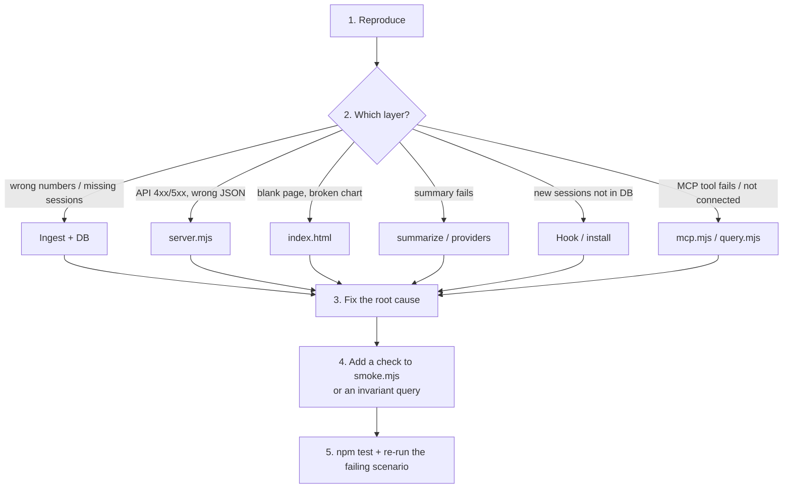

# Fixing bugs in Personal Brain

## 1. Reproduce

- Ask for / write down: steps, expected result, actual result, `brain version`.
- Reproduce on the **dev copy** (`npm run smoke -- --keep`, port 4399), not on the installed copy on 4377.
- Bug only shows on real data → read it read-only: `npm run db -- --installed "<SELECT …>"`.

## 2. Isolate by layer

**Ingest / DB** (`src/ingest.mjs`, `src/lib.mjs`)
- Compare numbers: `npm run db -- "SELECT id, project, title, n_prompts, cost_usd, cost_source FROM sessions WHERE project = '
' ORDER BY started_at DESC LIMIT 20"`.
- Missing session: is its `session_id` in `ingest_state`? Is the transcript in `~/.claude/projects/<dir>/<id>.jsonl`? Is the project wrongly grouped by `exclude` / `aliases` / `projectDepth` (`projectOf()`)?
- Cost mismatch: `cost_source = 'estimated'` means the transcript has no `cost-state`; see `estimateMissingCosts()`.
- Incremental ingest relies on an mtime/size signature → after changing parse logic, run `npm run ingest -- --full`.

**Server** (`src/server.mjs`)
- `curl -s "http://127.0.0.1:4399/api/<endpoint>"` to see raw JSON. 403 on POST = missing `x-brain: 1` or wrong Origin (by design).
- SQL errors are usually a table/column that was not migrated → check `openDb()`.

**UI** (`src/public/index.html`)
- Open the browser console. Common causes: `null` data (project without sessions), division by zero, strings not passed through `esc()`.
- `npm run check` catches syntax errors in the HTML script but not runtime errors.

**Search / MCP** (`src/query.mjs`, `src/mcp.mjs`)
- Wrong/missing search hits: check `search_fts` row counts per `kind`; the index is rebuilt after ingest/summarize (`rebuildSearchIndex()`).
- Test the MCP server directly: pipe JSON-RPC lines into `node --no-warnings src/mcp.mjs` (see the MCP block in `scripts/smoke.mjs`). Anything other than JSON-RPC on stdout breaks the protocol.
- Installed registration: `claude mcp get personal-brain` (read-only check).

**AI summary** (`src/summarize.mjs`, `src/providers.mjs`)
- 403 `no_key` = provider has no key/model. 409 = that project is already being summarized.
- Provider errors must be `ProviderError` with a clear message; truncated output → check token limits.
- Never call a real API with the user's key without their consent (it costs money).

**Hook / install**
- Hook log: `~/.personal-brain/ingest-hook.log`.
- Check that `~/.claude/settings.json` → `hooks.SessionEnd` points at `<install dir>/hook-sessionend.mjs` (read only, do not edit by hand).
- Stale install: compare `brain version` with `git log -1`; after a fix, reinstall (`/pb-install`).

## 3–5. Fix and prevent regression

- Fix the cause, do not mask the symptom (e.g. no `?? 0` to hide bad data coming from ingest).
- Add an assertion to `scripts/smoke.mjs`, or record an invariant query in the commit message.
- `npm test`, then re-run the exact original failing scenario.
- Commit as `fix: <short description>` + 1–2 sentences on the root cause.

Report to the user: root cause, what was changed (file:line), what was verified, what was not (e.g. UI not opened in a browser, installed copy not updated).
