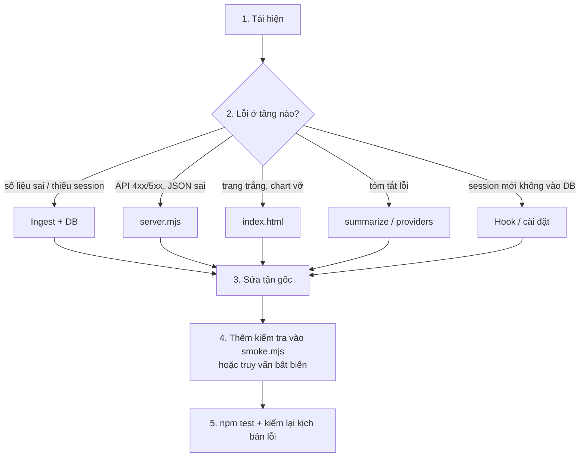

# Sửa lỗi Personal Brain

## 1. Tái hiện

- Hỏi/ghi rõ: bước làm, kết quả mong đợi, kết quả thật, `brain version`.
- Tái hiện trên **bản dev** (`npm run smoke -- --keep`, cổng 4399), không trên bản cài 4377.
- Lỗi chỉ có trên dữ liệu thật → đọc read-only: `npm run db -- --installed "<SELECT …>"`.

## 2. Khoanh vùng theo tầng

**Ingest / DB** (`src/ingest.mjs`, `src/lib.mjs`)
- So số liệu: `npm run db -- "SELECT id, project, title, n_prompts, cost_usd, cost_source FROM sessions WHERE project = '
' ORDER BY started_at DESC LIMIT 20"`.
- Session thiếu: kiểm `ingest_state` có `session_id` chưa; transcript có trong `~/.claude/projects/<dir>/<id>.jsonl` không; project có bị `exclude` / `aliases` / `projectDepth` gom sai không (`projectOf()`).
- Chi phí lệch: `cost_source = 'estimated'` nghĩa là transcript thiếu `cost-state`; xem `estimateMissingCosts()`.
- Ingest tăng dần dựa vào chữ ký mtime/size → sửa logic parse xong phải chạy `npm run ingest -- --full`.

**Server** (`src/server.mjs`)
- `curl -s "http://127.0.0.1:4399/api/<endpoint>"` xem JSON thô. 403 ở POST = thiếu `x-brain: 1` hoặc Origin sai (đúng thiết kế).
- Lỗi SQL thường do bảng/cột chưa migrate → kiểm `openDb()`.

**UI** (`src/public/index.html`)
- Mở console trình duyệt. Lỗi thường gặp: dữ liệu `null` (project không có session), chia cho 0, chuỗi không qua `esc()`.
- `npm run check` bắt lỗi cú pháp script trong HTML nhưng không bắt lỗi runtime.

**Tóm tắt AI** (`src/summarize.mjs`, `src/providers.mjs`)
- 403 `no_key` = provider chưa có key/model. 409 = đang tóm tắt project đó.
- Lỗi provider phải là `ProviderError` với thông báo rõ; kết quả bị cắt → kiểm giới hạn token.
- Không gọi API thật bằng key người dùng khi chưa được đồng ý (tốn tiền).

**Hook / cài đặt**
- Log hook: `~/.personal-brain/ingest-hook.log`.
- Kiểm `~/.claude/settings.json` → `hooks.SessionEnd` trỏ đúng `<thư mục cài>/hook-sessionend.mjs` (chỉ đọc, không sửa tay).
- Bản cài cũ: `brain version` so với `git log -1`; sửa xong phải cài lại (`/pb-install`).

## 3–5. Sửa và chặn tái phát

- Sửa nguyên nhân, không che triệu chứng (vd không `?? 0` để giấu dữ liệu sai từ ingest).
- Thêm assertion vào `scripts/smoke.mjs` hoặc ghi truy vấn bất biến trong mô tả commit.
- `npm test`, rồi chạy lại đúng kịch bản lỗi ban đầu.
- Commit dạng `fix: <mô tả ngắn>` + 1–2 câu nguyên nhân gốc.

Báo cáo cho người dùng: nguyên nhân gốc, đã sửa gì (file:dòng), đã kiểm gì, còn gì chưa kiểm (vd UI chưa mở trình duyệt, bản cài chưa cập nhật).
