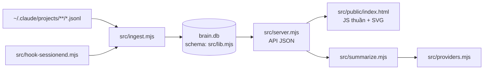

# Coding trong Personal Brain

## Bản đồ code

| File | Chứa | Sửa khi |
| --- | --- | --- |
| `src/lib.mjs` | `DEFAULTS` config, `SCHEMA`, `openDb()` + migration, `redact()`, `projectOf()`, `isExcluded()`, `localDay()` | thêm config key, bảng/cột, quy tắc đặt tên project |
| `src/ingest.mjs` | `listSessions` → `parseSession` (đọc JSONL) → `writeSession`; `estimateMissingCosts`; `ingestKnowledge`; `ingest()` | lấy thêm dữ liệu từ transcript |
| `src/server.mjs` | hàm truy vấn `usage()`, `activity()`, `projects()`, `project()`, `search()`, `settings()`; router trong `createServer` | thêm/sửa API |
| `src/public/index.html` | CSS, helper chart (`stackedBars`, `hBars`, `heatmap`, `sparkline`), view `renderUsage/renderPortfolio/renderProjectDetail/renderSearch/renderSettings`, router hash `route()` | sửa giao diện |
| `src/summarize.mjs` | `buildContext()` (prompt gửi AI), JSON schema kết quả, `normalize()`, `summarizeProject()` | đổi nội dung tóm tắt |
| `src/providers.mjs` | `PROVIDERS` (metadata UI) + `impl` (`listModels`, `generate`) mỗi provider | thêm provider |
| `scripts/install.mjs` | cài/nâng cấp, hook, shim `brain` | đổi cách cài |

## Công thức cho task thường gặp

**Thêm cột / bảng**
1. Thêm vào `SCHEMA` trong `src/lib.mjs` (bảng mới: `CREATE TABLE IF NOT EXISTS`).
2. DB cũ: thêm migration trong `openDb()` theo mẫu `if (!cols.has('x')) db.exec('ALTER TABLE … ADD COLUMN x …')`.
3. Ghi dữ liệu trong `writeSession()`; nếu cần dữ liệu cho session cũ → ghi chú người dùng chạy `brain ingest --full`.
4. Không `DROP` bảng/cột chứa dữ liệu người dùng.

**Thêm API endpoint**
1. Viết hàm truy vấn trong `src/server.mjs` (dùng helper `get`/`all`, tham số `?` — không nối chuỗi SQL với input).
2. Thêm dòng router: GET đọc dữ liệu; POST tự động bị chặn nếu không `trusted()`.
3. Thêm kiểm tra vào `scripts/smoke.mjs`.

**Sửa dashboard**
- Một file duy nhất `src/public/index.html`, không framework. Escape mọi chuỗi từ dữ liệu bằng `esc()` trước khi chèn HTML.
- Gọi POST bằng helper `post()` (tự thêm `x-brain: 1`).
- Màu dùng CSS variable có sẵn (hỗ trợ dark mode qua `prefers-color-scheme`).
- Route mới: thêm nhánh trong `route()` (hash `#/…`).

**Thêm config key**
1. Default trong `DEFAULTS` (`src/lib.mjs`); nếu là đường dẫn → thêm vào `PATH_KEYS`.
2. Mẫu + chú thích `_key` trong `src/config.example.json`.
3. Bảng cấu hình trong `README.md`.

**Thêm AI provider**
1. Metadata trong `PROVIDERS` (label, docs, keyPlaceholder, fields, effort?).
2. `impl[id]` với `listModels({ key, settings })` và hàm sinh JSON; lỗi ném `ProviderError` với thông báo tiếng Việt.
3. `providerReady()` nếu điều kiện "sẵn sàng" khác thường.

## Quy ước

- ES module `.mjs`, chỉ dùng built-in Node (`node:fs`, `node:sqlite`, `fetch`…). Hỏi người dùng trước khi thêm dependency.
- Code ngắn, hàm thuần; comment bằng tiếng Anh, text UI/log bằng tiếng Việt.
- Thời gian lưu dạng epoch ms; ngày dạng `YYYY-MM-DD` theo giờ local (`localDay()`).
- Đổi luồng hoạt động → cập nhật sơ đồ Mermaid trong `README.md` / `docs/PLAN.md`.

Xong code → làm theo skill `pb-testing`.
