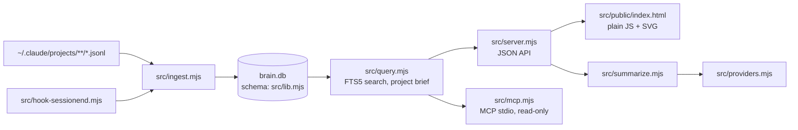

# Coding in Personal Brain

## Code map

| File | Contains | Change it to |
| --- | --- | --- |
| `src/lib.mjs` | config `DEFAULTS`, `SCHEMA`, `openDb()` + migrations, `redact()`, `projectOf()`, `isExcluded()`, `localDay()` | add a config key, table/column, project-naming rule |
| `src/ingest.mjs` | `listSessions` → `parseSession` (reads JSONL) → `writeSession`; `estimateMissingCosts`; `ingestKnowledge`; `ingest()` | pull more data from transcripts |
| `src/extensions.mjs` | `scanExtensions()` (skills/agents/commands from user dir, synced, plugins, project `.claude/`), `parseFrontmatter()`, `usageOfToolUse()` | change what counts as a skill/agent/command or its summary |
| `src/kit.mjs`, `src/kit/` | starter kit (sample skills/agents/commands) + `brain kit list/add/remove`; add never overwrites a modified copy, remove only deletes unmodified ones | add/change a sample, change the kit CLI (keep samples generic — public repo) |
| `src/server.mjs` | query functions `usage()`, `activity()`, `projects()`, `project()`, `search()`, `settings()`; router in `createServer` | add/change an API |
| `src/query.mjs` | `rebuildSearchIndex()` (FTS5 `search_fts` + `entities`), `search()`, `timeHint()`, `promptNeighbors()`, `resolveProject()`, `projectBrief()`, `recent()`, `extensionsOverview()` — shared by server + MCP | change search / what agents get back |
| `src/entities.mjs` | regex entity extraction (`extractEntities`), `rebuildEntities()` → table `entities`, `related()` (co-occurrence × idf) for `brain_related` | change what counts as an entity or how relatedness is scored |
| `src/mcp.mjs` | read-only stdio MCP server: `TOOLS` + handlers `brain_search/brain_related/brain_project/brain_recent/brain_profile`; stdout is for JSON-RPC only | add/change an MCP tool (add a check in `scripts/smoke.mjs`) |
| `src/public/index.html` | CSS, chart helpers (`stackedBars`, `hBars`, `heatmap`, `sparkline`), views `renderUsage/renderPortfolio/renderProjectDetail/renderSearch/renderSettings`, hash router `route()` | change the UI |
| `src/summarize.mjs` | `buildContext()` (prompt sent to the AI), result JSON schema, `normalize()`, `summarizeProject()` | change summary content |
| `src/providers.mjs` | `PROVIDERS` (UI metadata) + `impl` (`listModels`, `generate`) per provider | add a provider |
| `scripts/install.mjs` | install/upgrade, hook, MCP registration, `brain` shim | change installation |

## Recipes for common tasks

**Add a column / table**
1. Add it to `SCHEMA` in `src/lib.mjs` (new table: `CREATE TABLE IF NOT EXISTS`).
2. Old DBs: add a migration in `openDb()` following `if (!cols.has('x')) db.exec('ALTER TABLE … ADD COLUMN x …')`.
3. Write the data in `writeSession()`; if old sessions need it → tell the user to run `brain ingest --full`.
4. Never `DROP` tables/columns holding user data.
5. If the data should be searchable, add it to `rebuildSearchIndex()` in `src/query.mjs`.

**Add an API endpoint**
1. Write the query function in `src/server.mjs` (or `src/query.mjs` if MCP needs it too), using `get`/`all` with `?` parameters — never concatenate input into SQL.
2. Add a router line: GET reads data; POST is blocked automatically unless `trusted()`.
3. Add a check to `scripts/smoke.mjs`.

**Add an MCP tool**
1. Add the query to `src/query.mjs`, then an entry in `TOOLS` (name, description, `inputSchema`) and a handler in `HANDLERS` in `src/mcp.mjs`.
2. Keep it read-only and return compact text (clip long fields — the result goes into Claude's context).
3. Update the MCP checks in `scripts/smoke.mjs` (tool count, one call per tool) and the tool table in `README.md`.

**Change the dashboard**
- Single file `src/public/index.html`, no framework. Escape every data string with `esc()` before inserting HTML.
- Make POST calls with the `post()` helper (adds `x-brain: 1`).
- Use the existing CSS variables for colors (dark mode via `prefers-color-scheme`).
- New route: add a branch in `route()` (hash `#/…`).

**Add a config key**
1. Default in `DEFAULTS` (`src/lib.mjs`); if it is a path → add it to `PATH_KEYS`.
2. Sample + `_key` comment in `src/config.example.json`.
3. Config table in `README.md`.

**Add an AI provider**
1. Metadata in `PROVIDERS` (label, docs, keyPlaceholder, fields, effort?).
2. `impl[id]` with `listModels({ key, settings })` and a JSON-generating function; throw `ProviderError` with a Vietnamese message on errors.
3. `providerReady()` if "ready" has unusual conditions.

## Conventions

- ES modules `.mjs`, Node built-ins only (`node:fs`, `node:sqlite`, `fetch`…). Ask the user before adding a dependency.
- Short code, pure functions; comments and docs in English, UI/log text in Vietnamese.
- Times stored as epoch ms; days as `YYYY-MM-DD` in local time (`localDay()`).
- Changing a flow → update the Mermaid diagrams in `README.md` / `docs/PLAN.md`.

When the code is done → follow the `pb-testing` skill.
