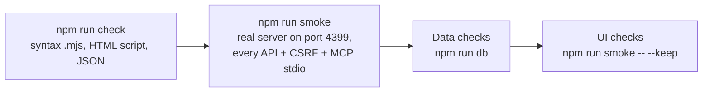

# Testing Personal Brain

The repo has no unit-test framework. Verification has these layers, run in order:



## 1. Automated — always run

```sh
npm test            # = check + smoke
```

- `check`: syntax errors in any `.mjs`, the script in `index.html`, `config.example.json`, `package.json`.
- `smoke` (`scripts/smoke.mjs`): starts `src/server.mjs` with `BRAIN_PORT=4399` on the dev DB `src/brain.db` and checks:
  - `/`, `/api/status|usage|insights|projects|project|activity|search|settings`;
  - search is accent-insensitive (`dinh` = `định`) and special characters do not break it;
  - the MCP server (`src/mcp.mjs`) over stdio: initialize, 4 read-only tools, one call per tool, `brain_search` time window (future → empty, bad date / since > until → isError), unknown method → -32601, nothing but JSON-RPC on stdout;
  - POST without `x-brain` / foreign Origin → 403, settings never expose API keys, server log has no errors;
  - `service.mjs` start/stop/status, then stops the server.
- No dev DB yet → smoke still runs (the server ingests on startup) but skips per-project tests; run `npm run ingest` first to get data.
- New API / feature / MCP tool → **add matching assertions to `scripts/smoke.mjs`**.

## 2. Data — when changing ingest / queries

```sh
npm run ingest -- --full                      # re-read every transcript into src/brain.db
npm run db -- --tables                        # row count per table
npm run db -- --schema sessions               # columns of a table
npm run db -- "SELECT project, COUNT(*) n, ROUND(SUM(cost_usd),2) cost FROM sessions GROUP BY 1 ORDER BY 3 DESC LIMIT 10"
```

Invariants worth checking:
- Daily cost totals match session totals:
  `SELECT ROUND((SELECT SUM(cost_usd) FROM usage) - (SELECT SUM(cost_usd) FROM sessions), 4) diff` → ~0.
- No secrets leaked into prompts: `SELECT COUNT(*) FROM prompts WHERE text GLOB '*sk-[A-Za-z0-9]*'` → 0.
- A second ingest changes nothing: run `npm run ingest` twice; the second run must report `0 session thay đổi` (0 sessions changed).
- Search index is complete: `SELECT kind, COUNT(*) FROM search_fts GROUP BY kind` matches the row counts of `sessions` (with a title), `prompts`, `knowledge`, `summaries`.

## 3. UI — when changing `index.html`

```sh
npm run smoke -- --keep        # server at http://127.0.0.1:4399, Ctrl+C to stop
```

Open: `#/projects`, one project detail page, `#/usage`, `#/search/<keyword>`, `#/settings`. Check the browser console has no errors, in both light and dark mode. If you cannot open a browser, tell the user the UI was not viewed directly.

## 4. Install — when changing `scripts/install.mjs` / `uninstall.mjs`

Use a temporary directory only, never the real install. Always pass `--no-mcp`: otherwise the test install re-registers the user's `personal-brain` MCP server to point at the temp dir.

```sh
node scripts/install.mjs --dir "$TMP/pb-test" --no-hook --no-shim --no-mcp --retention 0
node scripts/uninstall.mjs --dir "$TMP/pb-test" --purge
```

`--dry-run` shows the steps without changing anything.

## Don't

- Test on port 4377 or in `~/.personal-brain` (the user's real data) — except `npm run db -- --installed` (read-only).
- Say "tested" when only `check` ran. Report exactly which layers ran and which did not.
