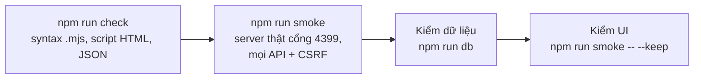

# Testing Personal Brain

Repo không có unit test framework. Kiểm chứng gồm 3 tầng, chạy theo thứ tự:



## 1. Tự động — luôn chạy

```sh
npm test            # = check + smoke
```

- `check`: lỗi cú pháp ở bất kỳ `.mjs`, script trong `index.html`, `config.example.json`, `package.json`.
- `smoke` (`scripts/smoke.mjs`): khởi động `src/server.mjs` với `BRAIN_PORT=4399` trên DB dev `src/brain.db`, gọi `/`, `/api/status|usage|projects|project|activity|search|settings`, kiểm POST thiếu `x-brain` / Origin lạ → 403, kiểm settings không lộ API key, kiểm log server không có lỗi, rồi tắt server.
- DB dev chưa có → smoke vẫn chạy (server tự ingest khi khởi động) nhưng bỏ qua test theo project; chạy `npm run ingest` trước để có dữ liệu.
- Thêm API / tính năng mới → **thêm assertion tương ứng vào `scripts/smoke.mjs`**.

## 2. Dữ liệu — khi sửa ingest / truy vấn

```sh
npm run ingest -- --full                      # đọc lại toàn bộ transcript vào src/brain.db
npm run db -- --tables                        # số dòng mỗi bảng
npm run db -- --schema sessions               # cột của bảng
npm run db -- "SELECT project, COUNT(*) n, ROUND(SUM(cost_usd),2) cost FROM sessions GROUP BY 1 ORDER BY 3 DESC LIMIT 10"
```

Bất biến nên kiểm:
- Tổng chi phí theo ngày khớp tổng theo session:
  `SELECT ROUND((SELECT SUM(cost_usd) FROM usage) - (SELECT SUM(cost_usd) FROM sessions), 4) diff` → ~0.
- Không có secret lọt vào prompt: `SELECT COUNT(*) FROM prompts WHERE text GLOB '*sk-[A-Za-z0-9]*'` → 0.
- Ingest lần 2 không đổi gì: chạy `npm run ingest` hai lần, lần sau phải báo `0 session thay đổi`.

## 3. Giao diện — khi sửa `index.html`

```sh
npm run smoke -- --keep        # server ở http://127.0.0.1:4399, Ctrl+C để dừng
```

Mở các trang: `#/projects`, một project chi tiết, `#/usage`, `#/search/<từ khoá>`, `#/settings`. Kiểm console trình duyệt không lỗi, cả light và dark mode. Nếu không mở được trình duyệt, nói rõ với người dùng là UI chưa được xem trực tiếp.

## 4. Cài đặt — khi sửa `scripts/install.mjs` / `uninstall.mjs`

Chỉ dùng thư mục tạm, không đụng bản cài thật:

```sh
node scripts/install.mjs --dir "$TMP/pb-test" --no-hook --no-shim --retention 0
node scripts/uninstall.mjs --dir "$TMP/pb-test" --purge
```

`--dry-run` để xem các bước mà không thay đổi gì.

## Không được

- Test trên cổng 4377 hoặc `~/.personal-brain` (dữ liệu thật của người dùng) — trừ `npm run db -- --installed` (read-only).
- Báo "đã test" khi chỉ chạy `check`. Báo đúng tầng nào đã chạy, tầng nào chưa.
