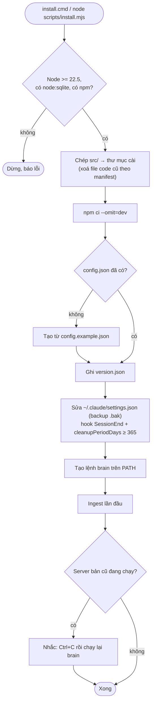
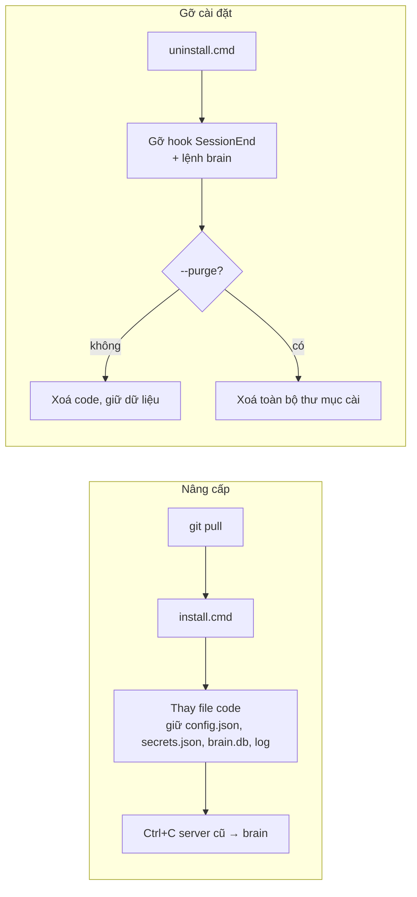
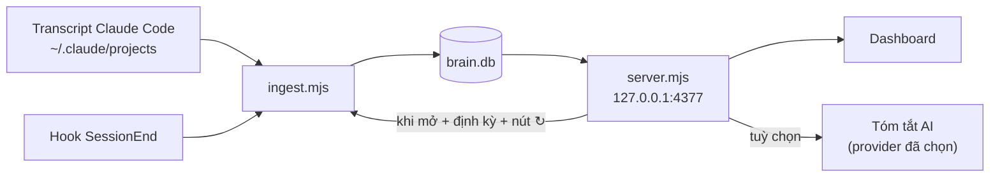
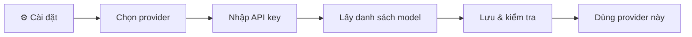

# Personal Brain

Dashboard chạy local, tổng hợp những gì bạn đã làm với **Claude Code**:

- **Dự án**: đang làm gì, đã làm gì, quyết định, knowledge. Có heatmap nhịp làm việc, timeline theo tuần, bảng Kanban, và tóm tắt bằng AI.
- **AI usage**: token, model, chi phí theo ngày / project / model / giờ trong ngày; tỉ lệ cache, tool lỗi, subagent.
- **💡 Gợi ý tối ưu**: cảnh báo khi Opus chiếm phần lớn chi phí (kèm ước tính tiết kiệm nếu chuyển sang Sonnet), dùng nhiều subagent, tool lỗi nhiều, cache hit thấp, session dài tốn kém, prompt gõ lặp lại; mỗi mục có việc nên làm cụ thể.

Dữ liệu đọc thẳng từ transcript của Claude Code (`~/.claude/projects`), lưu vào SQLite (`node:sqlite`) và **chỉ nằm trên máy của bạn**.
Tóm tắt AI là tùy chọn: hỗ trợ Anthropic (Claude), OpenAI, Google Gemini, Azure OpenAI và các API tương thích OpenAI (OpenRouter, DeepSeek, Groq, Ollama…).

## Yêu cầu

- Node.js **>= 22.5** (cần module `node:sqlite`)
- Claude Code đã từng chạy trên máy (đã có `~/.claude/projects`)
- Windows: API key được mã hóa bằng DPAPI. macOS/Linux: key lưu dạng file `0600`.

## Cài đặt

Mã nguồn: <https://github.com/hienct-fpt/personal-brain>

Windows:

```bat
git clone https://github.com/hienct-fpt/personal-brain.git
cd personal-brain
install.cmd
```

macOS/Linux:

```sh
git clone https://github.com/hienct-fpt/personal-brain.git
cd personal-brain
node scripts/install.mjs
```

Không có git: tải [file ZIP](https://github.com/hienct-fpt/personal-brain/archive/refs/heads/main.zip), giải nén rồi chạy `install.cmd` (hoặc `node scripts/install.mjs`) trong thư mục vừa giải nén. Cách này không nâng cấp bằng `git pull` được; khi có bản mới, tải lại ZIP rồi cài đè.

Script cài đặt làm các bước sau:

1. Kiểm tra Node.js / npm.
2. Chép `src/` vào thư mục cài (mặc định `~/.personal-brain`), rồi chạy `npm ci --omit=dev`.
3. Tạo `config.json` từ `config.example.json` nếu thư mục cài chưa có file này.
4. Ghi `version.json` (phiên bản + git commit).
5. Sửa `~/.claude/settings.json` (có backup `.bak`):
   - thêm hook **SessionEnd**: lưu session vào `brain.db` ngay khi session kết thúc, kể cả khi dashboard không chạy;
   - nâng `cleanupPeriodDays` lên ít nhất **365**, để Claude Code không xóa transcript sau 30 ngày.
6. Tạo lệnh `brain` trên PATH: Windows dùng `%LOCALAPPDATA%\Microsoft\WindowsApps\brain.cmd`, macOS/Linux dùng `~/.local/bin/brain`.
7. Đọc transcript lần đầu.



| Tùy chọn | Ý nghĩa |
| --- | --- |
| `--dir <path>` | Thư mục cài (mặc định `~/.personal-brain`) |
| `--retention <days>` | Giá trị tối thiểu cho `cleanupPeriodDays` (mặc định 365; `0` = không sửa) |
| `--no-hook` | Không đăng ký hook SessionEnd |
| `--no-shim` | Không tạo lệnh `brain` |
| `--no-ingest` | Không đọc transcript sau khi cài |
| `--dry-run` | Chỉ in ra những gì sẽ làm, không thay đổi gì |

**Nâng cấp** lên bản mới nhất trên GitHub. Chạy trong thư mục đã clone:

```sh
git pull
install.cmd                  # macOS/Linux: node scripts/install.mjs
```

Chỉ các file code bị thay; `config.json`, `secrets.json`, `brain.db` và log được giữ nguyên.
Nếu dashboard đang chạy, tắt nó (Ctrl+C) rồi chạy lại `brain`. Xem phiên bản đang cài bằng `brain version`.

**Gỡ cài đặt**: `uninstall.cmd` (macOS/Linux: `node scripts/uninstall.mjs`) gỡ hook và lệnh `brain`, xóa code nhưng giữ dữ liệu. Thêm `--purge` để xóa luôn dữ liệu.
Sau đó có thể xóa thư mục đã clone.



## Sử dụng

```text
brain                      mở dashboard  →  http://localhost:4377
brain ingest [--full]      đọc transcript mới (--full: đọc lại tất cả)
brain summarize "<proj>"   tóm tắt AI cho 1 project
brain version              phiên bản đang cài
```

Luồng dữ liệu:



Để dùng tóm tắt AI:



## Cấu hình (`config.json` trong thư mục cài)

| Khóa | Ý nghĩa |
| --- | --- |
| `workspaceRoot` | Thư mục chứa các project (mặc định `~/workspace`) |
| `projectDepth` | Số cấp thư mục tạo thành 1 project, ví dụ `{ "*": 1, "clients": 2 }` → `clients/acme-app` |
| `aliases` | `[{ "match": "<regex trên cwd>", "project": "<tên>" }]` để gom thư mục tạm vào một project |
| `exclude` | Prefix tên project không ghi nhận và không gửi lên AI |
| `port`, `refreshMinutes` | Cổng của server, chu kỳ tự đọc transcript |

## Phát triển

```bat
git clone https://github.com/hienct-fpt/personal-brain.git
cd personal-brain
npm install
npm run dev        :: chạy server từ src/ (dữ liệu dev tạo trong src/, đã gitignore)
npm run check      :: kiểm tra cú pháp toàn bộ .mjs, script dashboard, JSON
npm run smoke      :: chạy server dev ở cổng 4399, gọi mọi API, kiểm CSRF rồi tắt (--keep: giữ server chạy)
npm test           :: check + smoke — chạy trước khi commit
npm run db -- "SELECT …"   :: query read-only DB dev (--installed: DB đang cài, --tables, --schema <bảng>)
install.cmd        :: cài bản đang sửa vào ~/.personal-brain
```

Làm việc với Claude Code: `CLAUDE.md` mô tả quy tắc của repo. Trong `.claude/` có:

| Loại | Tên | Dùng khi |
| --- | --- | --- |
| Skill | `pb-coding` | thêm tính năng: bản đồ code, công thức thêm cột DB / API / config / provider |
| Skill | `pb-testing` | kiểm chứng thay đổi: check, smoke, kiểm dữ liệu, UI, installer |
| Skill | `pb-bugfix` | sửa lỗi: tái hiện, khoanh vùng theo tầng, chặn tái phát |
| Command | `/pb-check` | chạy `npm test` + xem git status |
| Command | `/pb-feature <mô tả>` | làm tính năng end-to-end |
| Command | `/pb-fix <lỗi>` | sửa lỗi theo quy trình |
| Command | `/pb-db <câu hỏi / SQL>` | hỏi dữ liệu trong `brain.db` |
| Command | `/pb-install` | test rồi cài bản đang sửa |
| Command | `/pb-release <patch\|minor\|x.y.z>` | bump version, tag, push |

Cấu trúc:

```text
src/
  lib.mjs              config, schema DB, che secret, đặt tên project
  ingest.mjs           transcript + memory files → brain.db
  server.mjs           HTTP server + API
  summarize.mjs        tóm tắt project bằng provider đang chọn
  providers.mjs        Anthropic SDK, OpenAI, Gemini, Azure OpenAI, OpenAI-compatible
  secrets.mjs          lưu API key (DPAPI trên Windows)
  hook-sessionend.mjs  hook SessionEnd → chạy ingest nền
  public/index.html    dashboard (JS thuần + SVG)
  brain.cmd            lệnh brain
  config.example.json  config mẫu
scripts/  install.mjs, uninstall.mjs, check.mjs, smoke.mjs, db.mjs
docs/PLAN.md           kế hoạch và quyết định thiết kế
```

## Bảo mật

- Server chỉ nghe ở `127.0.0.1`. Request POST phải có header `x-brain: 1` và Origin là chính server (chống CSRF).
- API key không bao giờ được gửi ra trình duyệt. Secret trong prompt bị che trước khi lưu.
- Tóm tắt AI gửi tiêu đề session, prompt và memory của project tới provider bạn chọn. Thêm project nhạy cảm vào `exclude` để chặn việc này.

## Báo lỗi & góp ý

Tạo issue tại <https://github.com/hienct-fpt/personal-brain/issues>. Kèm phiên bản (`brain version`), hệ điều hành, phiên bản Node.js và log lỗi nếu có (`ingest-hook.log` trong thư mục cài).
Trước khi gửi, kiểm tra log không chứa prompt hay đường dẫn nhạy cảm.
