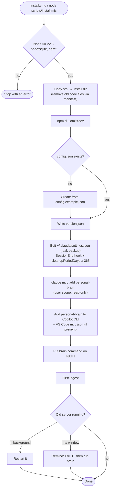
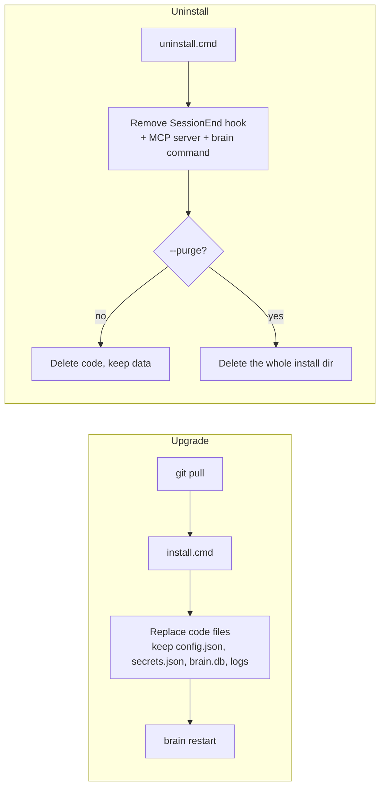
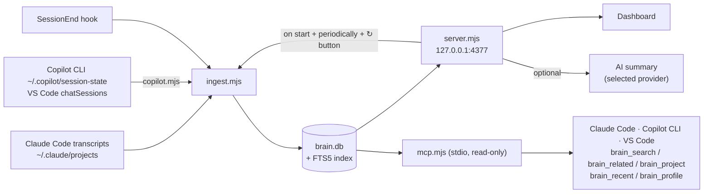
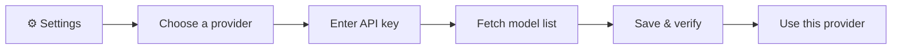

# Personal Brain

A local dashboard that pulls together what you have done with **Claude Code** and **GitHub Copilot** (Copilot CLI + VS Code Copilot Chat), plus a read-only MCP server so Claude Code itself can look things up in that history:

- **Projects**: what you are working on, what is done, decisions, knowledge. Includes an activity heatmap, a weekly timeline, a Kanban board and AI summaries.
- **AI usage**: tokens, models, cost by day / project / model / hour of day; cache hit rate, tool errors, subagents.
- **💡 Optimization tips**: warns when Opus dominates cost (with estimated savings from switching to Sonnet), heavy subagent use, many tool errors, low cache hit rate, long expensive sessions, repeated prompts; each item comes with a concrete action.
- **🧩 Skills**: which skills, subagents and slash commands exist on your machine (user, claude.ai-synced, plugins, every project's `.claude/`) and which ones you actually use — call counts, sessions, last use, projects — each with a content summary (frontmatter description + heading outline).
- **Personal knowledge for Claude**: Claude Code can search your past sessions, prompts, memory files and AI summaries from any project via MCP.

Data is read straight from Claude Code transcripts (`~/.claude/projects`), Copilot CLI sessions (`~/.copilot/session-state`) and VS Code Copilot Chat history (`<VS Code user dir>/workspaceStorage/*/chatSessions`), stored in SQLite (`node:sqlite`) and **stays on your machine**.
AI summaries are optional and support Anthropic (Claude), OpenAI, Google Gemini, Azure OpenAI and OpenAI-compatible APIs (OpenRouter, DeepSeek, Groq, Ollama…).

The dashboard UI is in Vietnamese.

## Requirements

- Node.js **>= 22.5** (needs the `node:sqlite` module)
- Claude Code has run on this machine before (`~/.claude/projects` exists)
- Windows: API keys are encrypted with DPAPI. macOS/Linux: keys are stored in a `0600` file.

## Install

Source: <https://github.com/hienct-fpt/personal-brain>

Windows:

```bat
git clone https://github.com/hienct-fpt/personal-brain.git
cd personal-brain
install.cmd
```

macOS/Linux:

```sh
git clone https://github.com/hienct-fpt/personal-brain.git
cd personal-brain
node scripts/install.mjs
```

Without git: download the [ZIP file](https://github.com/hienct-fpt/personal-brain/archive/refs/heads/main.zip), extract it and run `install.cmd` (or `node scripts/install.mjs`) in the extracted folder. This copy cannot be upgraded with `git pull`; for a new version, download the ZIP again and install over it.

The installer does the following:

1. Checks Node.js / npm.
2. Copies `src/` into the install directory (default `~/.personal-brain`), then runs `npm ci --omit=dev`.
3. Creates `config.json` from `config.example.json` if the install directory has none.
4. Writes `version.json` (version + git commit).
5. Edits `~/.claude/settings.json` (with a `.bak` backup):
   - adds a **SessionEnd** hook: each session is saved into `brain.db` as soon as it ends, even if the dashboard is not running;
   - raises `cleanupPeriodDays` to at least **365**, so Claude Code does not delete transcripts after 30 days.
6. Registers the read-only MCP server `personal-brain` with `claude mcp add --scope user`, so Claude Code can query the brain. Skipped if the `claude` command is not available.
   It is also added (with a `.bak` backup) to `~/.copilot/mcp-config.json` (Copilot CLI) and to the VS Code user `mcp.json` (stable and Insiders), if those are installed.
7. Puts a `brain` command on PATH: `%LOCALAPPDATA%\Microsoft\WindowsApps\brain.cmd` on Windows, `~/.local/bin/brain` on macOS/Linux.
8. Reads the transcripts for the first time.



| Option | Meaning |
| --- | --- |
| `--dir <path>` | Install directory (default `~/.personal-brain`) |
| `--retention <days>` | Minimum value for `cleanupPeriodDays` (default 365; `0` = leave unchanged) |
| `--no-hook` | Do not register the SessionEnd hook |
| `--no-shim` | Do not create the `brain` command |
| `--no-mcp` | Do not register the `personal-brain` MCP server (anywhere) |
| `--no-copilot` | Do not register it for Copilot CLI / VS Code |
| `--no-ingest` | Do not read transcripts after installing |
| `--dry-run` | Only print what would happen, change nothing |

**Upgrade** to the latest version on GitHub. Run in the cloned folder:

```sh
git pull
install.cmd                  # macOS/Linux: node scripts/install.mjs
```

Only code files are replaced; `config.json`, `secrets.json`, `brain.db` and logs are kept.
A dashboard running in the background is restarted automatically; one running in a terminal window must be stopped (Ctrl+C) and started again with `brain`. Check the installed version with `brain version`.

**Uninstall**: `uninstall.cmd` (macOS/Linux: `node scripts/uninstall.mjs`) removes the hook, the `personal-brain` MCP server (Claude Code, Copilot CLI, VS Code) and the `brain` command, and deletes the code but keeps your data. Add `--purge` to delete the data too.
You can then delete the cloned folder.



## Usage

```text
brain                      open the dashboard in this terminal window  →  http://localhost:4377
brain start                run the dashboard in the background (no window needed; log: server.log in the install dir)
brain stop | restart       stop / restart the server (after upgrading: brain restart)
brain status               is the server running, which version, does it start at logon
brain autostart on|off     start in the background at Windows logon
brain ingest [--full]      read new transcripts (--full: re-read everything)
brain summarize "<proj>"   AI summary for one project
brain version              installed version
brain kit                  list the starter kit (sample skills / agents / slash commands)
brain kit add <name…|all>  copy them into ./.claude  (--dir <project>, --user = ~/.claude, --force, --dry-run)
brain kit remove <name…>   remove them again (only unmodified copies unless --force)
```

**Search** (search box on the dashboard): SQLite FTS5 over session titles, prompts, knowledge, AI summaries and skill/agent/command descriptions. Accent-insensitive ("quyet dinh" matches "quyết định"), prefix matching, ranked by relevance.

### Starter kit (`brain kit`)

Sample skills, subagents and slash commands you can copy into any project's `.claude/` (or `~/.claude` with `--user`). Run `brain kit add …` from the project folder; existing or locally modified files are never overwritten without `--force`, and `remove` only deletes unmodified copies. The 🧩 Skills tab shows where each item is already installed.

| Kind | Name | What it does |
| --- | --- | --- |
| skill | `brain-recall` | pulls prior context for the current project from Personal Brain (MCP) before non-trivial work |
| skill | `bugfix-flow` | reproduce → isolate → fix root cause → regression check → honest report |
| skill | `verify-before-done` | finds and runs the project's own lint/test/build commands, reviews the diff |
| agent | `code-reviewer` | read-only review of uncommitted changes (sonnet) |
| agent | `test-runner` | runs checks, returns a compact pass/fail summary (haiku) |
| agent | `brain-researcher` | searches your history via the MCP tools, returns a dated brief (haiku) |
| command | `/brain [topic]` | brief on the current project: current work, decisions, open items, recent sessions |
| command | `/recap [file]` | session recap for handoff (goal, done, decisions, verified, next) |
| command | `/check [scope]` | run the project's checks and summarize |
| command | `/commit-msg` | draft a commit message from the staged diff (does not commit) |

### Ask the brain from Claude Code (MCP)

The installer registers the MCP server `personal-brain` (user scope, read-only), so Claude Code in **any project** can look up your work history:

| Tool | For questions like | Returns |
| --- | --- | --- |
| `brain_search(query, project?, kinds?, since?, until?, days?, limit?, context?)` | "how did I fix the CSRF bug last time?", "what did I decide about X in October?" | best-matching prompts / sessions / knowledge / AI summaries / installed skills·agents·commands, with excerpt and date. Ranked by relevance with a boost for recent items; `since`/`until` (`YYYY-MM-DD`) or `days` limit the time window. Without them, a time cue written in the query ("tuần trước", "tháng 9", "3 ngày qua", "last month", "2026-10"…) is detected and applied. The first 5 prompt hits come with the prompt just before/after in the same session |
| `brain_related(entity, project?, limit?)` | "what usually changes together with `query.mjs`?", "where did I work on ticket ABC-123?" | files, tickets, skills/agents/commands and `identifiers` that co-occur with the entity in the same sessions/memories (weighted, common ones damped), plus the sessions that mention it |
| `brain_project(name?)` | "where is project X at, what did we decide?" | AI summary, knowledge (tagged with its memory type), recent sessions, most-edited files, latest prompts. Empty `name` = current project |
| `brain_recent(days?, project?)` | "what did I work on this week?" | sessions grouped by day, with prompt count and cost |
| `brain_profile(type?)` | "how does this user like to work?" | memories of type `user` (who you are) and `feedback` (how you want Claude to work), gathered from every project |

Just ask normally in Claude Code; Claude calls the tools when needed. Check with `claude mcp get personal-brain` or `/mcp` inside Claude Code.
Register manually (if you installed with `--no-mcp`, or `claude` was not available at install time):

```sh
claude mcp add --scope user personal-brain -- node --no-warnings "<install dir>/mcp.mjs"
```

**GitHub Copilot** uses the same tools: the installer adds `personal-brain` to `~/.copilot/mcp-config.json` and the VS Code user `mcp.json`. Manual entries:

```jsonc
// ~/.copilot/mcp-config.json
{ "mcpServers": { "personal-brain": { "type": "local", "command": "node", "args": ["--no-warnings", "<install dir>/mcp.mjs"], "tools": ["*"] } } }
// VS Code: Command Palette → "MCP: Open User Configuration"
{ "servers": { "personal-brain": { "type": "stdio", "command": "node", "args": ["--no-warnings", "<install dir>/mcp.mjs"] } } }
```

`brain_project` gives the richest answer once the project has an AI summary (`brain summarize "<project>"`).
Note: tool results go into Claude's context, i.e. through the Claude API like everything else in the session.

Data flow:



To use AI summaries (in the dashboard's **⚙ Cài đặt** / Settings tab):



## Configuration (`config.json` in the install dir)

| Key | Meaning |
| --- | --- |
| `workspaceRoot` | Folder containing your projects (default `~/workspace`) |
| `projectDepth` | How many folder levels make up a project, e.g. `{ "*": 1, "clients": 2 }` → `clients/acme-app` |
| `aliases` | `[{ "match": "<regex on cwd>", "project": "<name>" }]` to group temporary folders into one project |
| `exclude` | Project-name prefixes that are not recorded and never sent to an AI |
| `port`, `refreshMinutes` | Server port, interval for re-reading transcripts |
| `copilotDir` | Copilot CLI home (default `~/.copilot`); `null` = don't read Copilot CLI sessions |
| `vscodeUserDirs` | VS Code user dirs to read Copilot Chat from; `null` (default) = auto-detect stable + Insiders, `[]` = off |

GitHub Copilot notes: Copilot sessions are tagged *Copilot CLI* / *Copilot VS Code* in the dashboard and in MCP results, and their models are shown as `copilot · <model>`. Cost = AI credits × $0.01 (the rate Copilot publishes model prices in). Older VS Code chats did not record credits or tokens, so they count as $0. Copilot sessions are picked up by the periodic refresh (there is no SessionEnd hook for Copilot).

## Development

```bat
git clone https://github.com/hienct-fpt/personal-brain.git
cd personal-brain
npm install
npm run dev        :: run the server from src/ (dev data is created in src/, gitignored)
npm run check      :: syntax-check every .mjs, the dashboard script, JSON
npm run smoke      :: dev server on port 4399, call every API, check CSRF and the MCP server, then stop (--keep: leave it running)
npm test           :: check + smoke — run before committing
npm run db -- "SELECT …"   :: read-only query on the dev DB (--installed: installed DB, --tables, --schema <table>)
install.cmd        :: install the working copy into ~/.personal-brain
```

Working with Claude Code: `CLAUDE.md` describes the repo rules. `.claude/` contains:

| Type | Name | Use for |
| --- | --- | --- |
| Skill | `pb-coding` | adding features: code map, recipes for DB columns / APIs / MCP tools / config / providers |
| Skill | `pb-testing` | verifying changes: check, smoke, data, UI, installer |
| Skill | `pb-bugfix` | fixing bugs: reproduce, isolate by layer, prevent regressions |
| Command | `/pb-check` | run `npm test` + show git status |
| Command | `/pb-feature <description>` | build a feature end-to-end |
| Command | `/pb-fix <bug>` | fix a bug following the process |
| Command | `/pb-db <question / SQL>` | query `brain.db` |
| Command | `/pb-install` | test, then install the working copy |
| Command | `/pb-release <patch\|minor\|x.y.z>` | bump version, tag, push |

Layout:

```text
src/
  lib.mjs              config, DB schema, secret redaction, project naming
  ingest.mjs           transcripts + memory files → brain.db
  copilot.mjs          GitHub Copilot sources: Copilot CLI events.jsonl, VS Code chatSessions (.json / .jsonl mutation log)
  query.mjs            shared queries: FTS5 index + search, project brief, recent sessions
  server.mjs           HTTP server + API
  mcp.mjs              read-only MCP server (stdio) for Claude Code
  service.mjs          brain start|stop|restart|status|autostart
  summarize.mjs        project summary with the selected provider
  providers.mjs        Anthropic SDK, OpenAI, Gemini, Azure OpenAI, OpenAI-compatible
  secrets.mjs          API key storage (DPAPI on Windows)
  hook-sessionend.mjs  SessionEnd hook → background ingest
  public/index.html    dashboard (plain JS + SVG)
  brain.cmd            the brain command
  config.example.json  sample config
scripts/  install.mjs, uninstall.mjs, check.mjs, smoke.mjs, db.mjs
docs/PLAN.md           plan and design decisions
```

## Security

- The server listens on `127.0.0.1` only. POST requests need the `x-brain: 1` header and the server's own Origin (CSRF protection).
- API keys are never sent to the browser. Secrets in prompts are redacted before storage.
- The MCP server is read-only and talks over stdio only (no network port).
- Copilot data is only read (never modified). Prompts from Copilot go through the same secret redaction; tool output and file contents are not stored.
- AI summaries send session titles, prompts and project memory to the provider you choose. Add sensitive projects to `exclude` to prevent this.

## Bugs & feedback

Open an issue at <https://github.com/hienct-fpt/personal-brain/issues>. Include the version (`brain version`), OS, Node.js version and any error log (`ingest-hook.log` / `server.log` in the install dir).
Before sending, make sure the log contains no sensitive prompts or paths.
