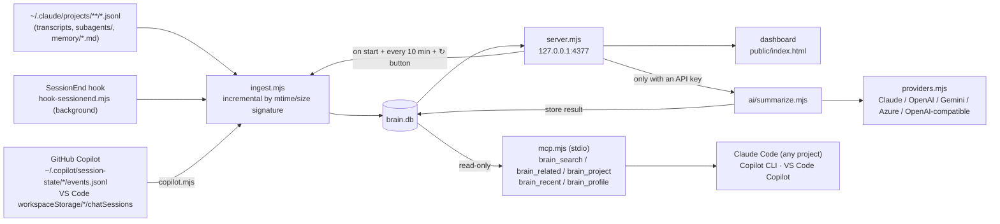
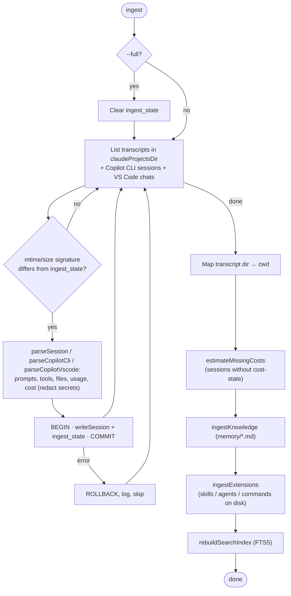
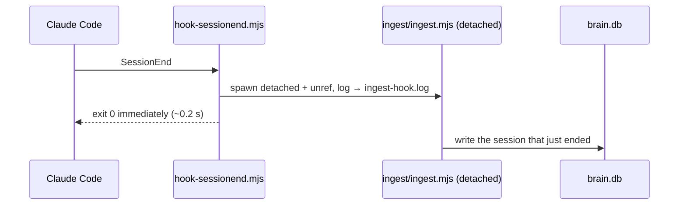
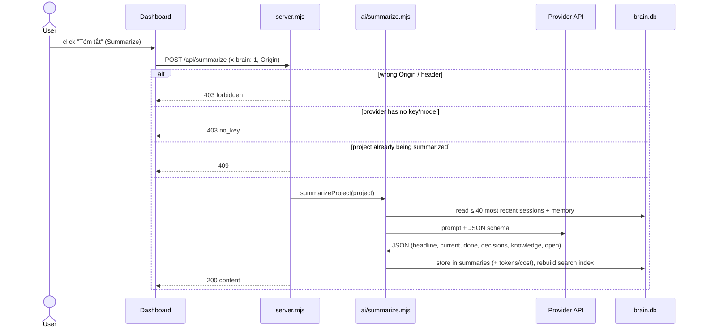
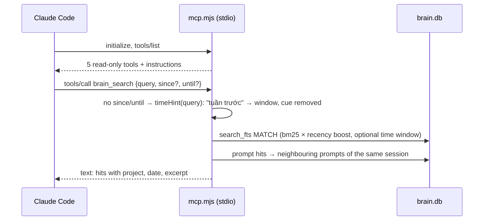

# Personal Brain — implementation plan (self-built version)

> Created: 2026-11-09 · Status: **v0.8.0 — v1 working + 💡 optimization tips + background mode (`brain start`) + MCP server for Claude Code + FTS5 search + GitHub Copilot (CLI + VS Code Chat)** (local dashboard reading Claude Code and Copilot history)

## 1. Goals

A local **personal memory** that can answer:

1. **Projects**: what am I working on, what have I done, what did I decide, what knowledge belongs to each project.
2. **Actual AI usage**: tokens, models, cost by day / project / model / hour of day.

And makes that memory available to Claude Code itself (MCP), so past work can be recalled from any project.

Out of scope (v1): knowledge graph, vector search, screen recording, multi-device sync, AI sources other than Claude Code.

## 2. Changes from v0.4

| v0.4 (planned) | v0.5 (actual) | Reason |
| --- | --- | --- |
| `capture.mjs` hook writes prompts/files to `inbox.jsonl` | **Dropped.** Read transcripts `~/.claude/projects/**/*.jsonl` directly | Transcripts already contain everything: prompts, tools/files, tokens per model, `cost-state` (USD cost computed by Claude Code) |
| `remember.mjs` calls `claude -p` at the end of each session | Summaries **per project, on demand**, via **the API of a chosen provider** (Claude, OpenAI, Gemini, Azure OpenAI, OpenAI-compatible) | A whole-project summary is more useful than one per session; only enabled once an API key is registered |
| CLI `brain today/week/search` | **Web dashboard** `http://localhost:4377` | Needs visuals: heatmap, timeline, cost charts |
| No dependencies | 1 dependency: `@anthropic-ai/sdk` | Call the Claude API with the official SDK |

## 3. Principles

1. **All code is `.mjs`** (ES modules, Node ≥ 22.5). SQLite via built-in `node:sqlite` (with FTS5). Run with `--no-warnings` because `node:sqlite` is still flagged experimental on Node 22.
2. **Source of truth = Claude Code transcripts.** `brain.db` is an archive: sessions already read are not lost when the original transcripts are cleaned up.
3. **Hooks never break a session**: always `exit 0`, heavy work runs in the background (`detached` + `unref()`).
4. **Local, outside the repo**: `%USERPROFILE%\.personal-brain\`, server binds to `127.0.0.1` only.
5. **AI is optional**: without an API key all statistics still work; only summaries are disabled.

## 4. Flows

### 4.1 Overall data flow



After every ingest or summary, the `search_fts` (FTS5) index is fully rebuilt from `sessions`, `prompts`, `knowledge`, `summaries` and `extensions` (name + description + outline only). At ~1,200 rows this takes about 0.4 s. The `entities` table is rebuilt in the same pass (~1 s on ~100 sessions).

### 4.2 Incremental ingest



### 4.3 SessionEnd hook



### 4.4 AI summary



### 4.5 MCP server



Launched by Claude Code per session (`claude mcp add --scope user`). The default project for `brain_project` is derived from the session's working directory (`CLAUDE_PROJECT_DIR` or cwd).

## 5. Directory layout

```text
%USERPROFILE%\.personal-brain\
├─ config.json          # project grouping, aliases, exclude, summary model/effort/language
├─ core/
│  ├─ lib.mjs           # paths, config, DB schema + migrations, secret redaction, project names
│  └─ secrets.mjs       # per-provider API key storage, encrypted with Windows DPAPI
├─ ingest/
│  ├─ ingest.mjs        # transcripts + memory files → brain.db
│  ├─ copilot.mjs       # GitHub Copilot CLI + VS Code Copilot Chat sources
│  └─ extensions.mjs    # skills / agents / slash commands on disk + frontmatter/outline summary
├─ query/
│  ├─ query.mjs         # shared queries: FTS5 index + search, project brief, recent sessions
│  └─ entities.mjs      # entity extraction + co-occurrence for brain_related
├─ ai/
│  ├─ summarize.mjs     # summarize one project with the selected provider
│  └─ providers.mjs     # Anthropic (SDK), OpenAI, Gemini, Azure OpenAI, OpenAI-compatible (fetch)
├─ server.mjs           # HTTP server + JSON API
├─ kit.mjs              # brain kit list|add|remove: copy the starter kit into <project>/.claude or ~/.claude
├─ kit/                 # starter kit: skills/ (brain-recall, bugfix-flow, verify-before-done), agents/ (code-reviewer, test-runner, brain-researcher), commands/ (brain, recap, check, commit-msg)
├─ mcp.mjs              # read-only stdio MCP server for Claude Code (registered with claude mcp add)
├─ service.mjs          # brain start|stop|restart|status|autostart (background, HKCU Run)
├─ hook-sessionend.mjs  # SessionEnd hook: start ingest in the background and exit immediately
├─ public/index.html    # dashboard (plain JS + SVG)
├─ brain.cmd            # brain | brain start/stop/restart/status/autostart | brain ingest [--full] | brain summarize "<project>"
├─ secrets.json         # encrypted API keys (never committed, not portable to other machines)
├─ brain.db             # SQLite
├─ server.log           # background server log (truncated above 5 MB)
└─ ingest-hook.log      # hook log
```

## 6. Data (`brain.db`)

| Table | Contents | Source |
| --- | --- | --- |
| `sessions` | project, cwd, title (`ai-title`), times, prompt count, cost + cost source (`reported`/`estimated`), lines +/−, tools used, files edited, tool errors, subagents | transcript |
| `prompts` | prompts the user typed (secrets redacted, max 1,500 chars) | transcript |
| `usage` | one row per API call: model, input/output/cache-read/cache-write tokens, allocated cost | transcript |
| `model_cost` | USD cost per model per session | `cost-state` |
| `knowledge` | memory files Claude saved per project, with their frontmatter `type` (`user` / `feedback` / `project` / `reference`, top-level or under `metadata:`). `user` + `feedback` = the person-level profile, shown across projects (dashboard "👤 Về bạn", MCP `brain_profile`) | `~/.claude/projects/*/memory/*.md` |
| `summaries` | AI summary per project (JSON) + tokens/cost of that run | provider API |
| `extensions` | skills (`skills/<n>/SKILL.md`), subagents (`agents/**/*.md`), slash commands (`commands/**/*.md`): scope (`user`/`synced`/`plugin`/`project`), description, heading outline, model/tools, body (redacted, ≤ 6,000 chars); rebuilt every ingest | `~/.claude/`, `~/.claude/skills/synced/*/`, installed plugins, `<project>/.claude/` (workspace tree, depth 4) |
| `ext_usage` | one row per `Skill` call, `Agent`/`Task` launch (by `subagent_type`) and `/command` typed | transcript |
| `ingest_state` | mtime/size signature per session for incremental ingest; `PRAGMA user_version` < `INGEST_VERSION` forces one full re-ingest when new fields are extracted | — |
| `entities` | entity graph: one row per (unit, entity) — unit = session or memory file; entity = file name, ticket (`ABC-123`, `#123`), `` `identifier` `` from prompts (regex, no NER/LLM), edited files, used skills/agents/commands; `n` = occurrences (capped at 5). Derived, rebuilt with `search_fts` | the tables above |
| `search_fts` | FTS5 index (unicode61, diacritics removed, `đ`→`d` folded by us); derived data, can be rebuilt any time | the tables above |

**Cost:**

- Taken from `cost-state`, which Claude Code computes at list API prices. This is not what you actually pay on a subscription plan.
- Each session's cost is spread over its API calls by token weight, so daily totals match session totals exactly (verified: difference 0).
- Sessions without `cost-state` are estimated with a $/token rate learned from sessions that have one, and labeled "ước" (estimated).

**Project grouping:** paths under `workspaceRoot`, cut at `projectDepth`. Example `clients/acme-app`: the `clients` group takes 2 levels. `aliases` group temporary folders, e.g. `tmp-*` into `clients/acme-app`.

## 7. Dashboard

UI labels are in Vietnamese; English meanings are given in parentheses.

**"Dự án" (Projects) tab** (inspired by Linear/Asana Portfolio, GitHub contributions, Kanban, activity feeds):

- **Overview page:**
  - Stat tiles: active projects, working days in the last 28 days, 30-day cost, projects with an AI summary.
  - Activity heatmap across all projects.
  - Filters by status ("Đang chạy" active ≤ 7 days / "Chậm lại" slowing ≤ 21 / "Tạm dừng" paused ≤ 60 / "Lưu trữ" archived), by client group, by name.
  - Project cards: one-line description, current work, 28-day sparkline.
- **Detail page:**
  - Header: summary sentence and 6 stats (sessions, prompts, working days, cost, lines of code, knowledge).
  - Kanban board **"Đang làm" (In progress) / "Còn mở" (Open) / "Quyết định" (Decisions)**.
  - Weekly timeline (sessions + ✅ completed items; sessions with ≤ 1 prompt are collapsed).
  - Heatmap, knowledge, most-edited files by folder, prompt history.

**AI usage tab:**

- Stat tiles: cost, tokens, sessions, prompts, cache hit rate, lines of code, tool errors/subagents.
- Charts: cost per day (split by model), per project, per hour of day.
- Per-model table; most expensive sessions table. Filter by 7/30/90 days/all.

**"💡 Gợi ý" (Tips) tab** (`GET /api/insights?days=`): fixed rules in `TIP_RULES` (`src/server.mjs`), no AI calls.

| Check | Threshold | Suggestion |
| --- | --- | --- |
| Opus share | ≥ 80% of cost (high ≥ 90%) | `opusplan`, `model: sonnet` for commands/skills; savings estimated from actual Sonnet vs Opus price/units |
| Subagents | ≥ 20 in the period | assign a cheaper model to agents, limit fan-out |
| Tool errors | ≥ 20/project or ≥ 5/session | write the correct commands into CLAUDE.md, allowlist permissions |
| Cache hit | < 80% on a project ≥ $2 | avoid switching model/CLAUDE.md mid-session, avoid long pauses |
| Long sessions | ≥ 40 prompts and ≥ $30 | `/clear`, `/compact`, handoff |
| Repeated prompts | ≥ 3 times (ignoring `/…`, text > 300 chars) | turn into a slash command / hook |

The number of "Ưu tiên cao" (high priority) tips is shown as a badge on the tab.

**"🧩 Skills" tab** (`GET /api/extensions?days=`, `GET /api/extension?path=`): skills, subagents and slash commands, merged by name (copies in nested repos, user + synced; a skill and a command with the same name are one item, since a skill is invoked as `/name`; `plugin:name` usage matches `name`).
- Tiles: used / on disk per kind, plus built-ins (usage with no file: `/clear`, `general-purpose`, `Explore`…).
- Table: content summary (description + outline + model/tools), where copies live, calls, sessions, last use, top projects. Filters: kind, "used only", text. Clicking a name shows the full file.
- The project detail page lists the skills/agents/commands used in that project and those in its `.claude/`.
- "📦 Bộ mẫu" (starter kit) card (`GET /api/kit`): every kit item, where it is already installed, and the `brain kit add <name>` command to copy. Installing is CLI-only (the browser never writes into project folders).

**"⚙ Cài đặt" (Settings):** register/verify/delete API keys; choose model, effort, summary language.

**Search:** FTS5 over session titles, prompts, knowledge, AI summaries and skill/agent/command descriptions. Accent-insensitive, prefix matching. If no result matches every word, falls back to matching any word. Ranking = bm25 × recency boost: up to 1.5× for an item from today, the boost halving every 60 days (`RECENCY_*` in `src/query/query.mjs`; items without a timestamp get none). `search()` takes an optional `since`/`until` window; the MCP `brain_search` exposes it as `since`/`until` (`YYYY-MM-DD`, local day, inclusive) or `days` — time-scoped retrieval is one of the hardest abilities in LongMemEval (ICLR 2025).

**Zero-token memory ideas (from Zero-Mem, arXiv 2607.29377)** — all deterministic, no LLM call:
- *Time cue in the query:* `timeHint()` (`src/query/query.mjs`) maps phrases like "hôm qua", "tuần trước", "tháng 9", "3 ngày qua", "last month", "2026-10", "ngày 5/10" to a window and strips them from the keywords. Used by `brain_search` only when no explicit `since`/`until`/`days` is given; the tool output states how the cue was read.
- *Local span:* prompt hits carry the previous/next prompt of the same session (`promptNeighbors()`), because a prompt alone is often "ok làm đi".
- *Entity graph:* `brain_related` (`src/entities.mjs`) scores entities co-occurring with the query entity as Σ over shared units of n(e,u)/Σn(u) × ln(1 + N/df(e)) — the share of each unit (Zero-Mem Eq. 4) damped by idf. One hop only; no PageRank, no embeddings (no extra dependency).

## 8. AI summaries

- **Condition:** only enabled when the selected provider has an API key and a model. Otherwise the button is disabled and the server returns 403.
- **Supported providers** (one key per provider, one provider active):

| Provider | How it is called | Key check / model list | JSON enforcement |
| --- | --- | --- | --- |
| Anthropic (Claude) | `@anthropic-ai/sdk`, default `claude-opus-5-5`, effort `medium`, `fallbacks: "default"` | `GET /v1/models` | structured output (`output_config.format`) |
| OpenAI | REST `/v1/chat/completions` | `GET /v1/models` (embedding/tts/image… filtered out) | `json_schema` → `json_object` → plain |
| Google Gemini | REST `generateContent` | `GET /v1beta/models` (only models supporting generateContent) | `responseSchema` → `application/json` only |
| Azure OpenAI | REST `/openai/deployments/{deployment}/chat/completions` (endpoint + API version) | deployment list | as OpenAI |
| OpenAI-compatible | REST `{baseUrl}/chat/completions` (OpenRouter, DeepSeek, Groq, Mistral, xAI, Ollama, LM Studio…), key optional | `GET {baseUrl}/models` | as OpenAI |

- **Model:** picked from the list fetched live from the provider's API; no hard-coded model names.
- **Key storage:** the key is verified with the model-list API (no tokens spent), then stored encrypted with **Windows DPAPI** in `secrets.json`. The server never returns keys to the browser.
- **Data sent:** up to the 40 most recent sessions (title, a few prompts, edited files) + the project's memory files.
- **Result:** headline, current, done (with dates), decisions, knowledge, open; the model output is normalized to that shape. Includes token counts; USD cost can only be estimated for Claude models.
- **Verified:** wrong keys are rejected with a clear error on all 5 providers; the full summary flow ran against a mock OpenAI-compatible server. Not yet run with a real key on any provider.

## 9. Hook & data retention

Installed in `~/.claude/settings.json` (2026-11-09):

```json
"SessionEnd": [{ "hooks": [{ "type": "command",
  "command": "node --no-warnings \"<install dir>/hook-sessionend.mjs\"", "timeout": 10 }] }],
"cleanupPeriodDays": 365
```

- The hook puts the session that just ended into `brain.db` even when the server is not running. Takes about 0.2 s, runs in the background, always `exit 0`.
- `cleanupPeriodDays` = 365: transcripts are kept for 1 year instead of 30 days (the old default lost transcripts of older projects).
- No `UserPromptSubmit` / `PostToolUse` hooks needed: the transcript already contains that data.

## 10. Privacy & security

- Secrets (`api_key|token|password|secret|bearer`, `sk-…`, `ghp_…`, `AKIA…`, JWT) are redacted before prompts and knowledge are stored.
- `config.json → exclude`: projects that are not recorded.
- File contents and command output are never stored, only file paths.
- The server listens on `127.0.0.1` only. POST requests require the `x-brain: 1` header and the server's own Origin (blocks CSRF from other websites).
- The MCP server is read-only and runs over stdio only (no port). Tool results go into the context of the Claude Code session that asked.
- AI summaries send project prompts/titles/memory to the provider API. For sensitive client projects, add them to `exclude` or do not run summaries.

## 11. Status & roadmap

| Step | Work | Status |
| --- | --- | --- |
| 1. Validation | `node:sqlite` + FTS5 on Node v22.19.0; transcript format, `cost-state` | ✅ |
| 2. Ingest | transcripts + subagents + memory files, incremental | ✅ 70 sessions, costs reconcile |
| 3. Dashboard | Projects (portfolio + detail), AI usage, 💡 tips, search | ✅ |
| 4. AI summaries | 5 providers (Claude, OpenAI, Gemini, Azure OpenAI, OpenAI-compatible), gated by API key, ⚙ Settings | ✅ code done — **not yet tried with a real key** |
| 5. Hook & retention | SessionEnd + `cleanupPeriodDays` 365 | ✅ installed — confirmed via `ingest-hook.log` after the next session |
| 6. Brain for Claude | read-only MCP server (`brain_search`, `brain_related`, `brain_project`, `brain_recent`, `brain_profile`) + FTS5 search; memory types + person-level profile; time-window search with recency ranking | ✅ smoke-tested over stdio, registered and connected — not yet tried inside a real Claude Code session |
| 7. (Later) | "Summarize all active projects" button; SessionStart hook injecting the project summary; more sources (git commits) | — |
| 8. GitHub Copilot | ingest Copilot CLI (`~/.copilot/session-state/*/events.jsonl`) + VS Code Copilot Chat (`workspaceStorage/*/chatSessions`, `.json` and `.jsonl` mutation log); `sessions.source`; cost = AI credits × $0.01; MCP registered for Copilot CLI + VS Code | ✅ smoke-tested with fixtures + real local data |

## 12. Open decisions

1. ~~Script language~~ → **Node.js, all `.mjs`** (2026-11-09).
2. ~~Summary language~~ → **Vietnamese by default**, changeable in ⚙ Settings.
3. ~~Docs language~~ → **English** for all `*.md` (2026-11-10); UI stays Vietnamese.
4. Which projects should go into `exclude` (sensitive client projects that must not be sent to an AI API)?
