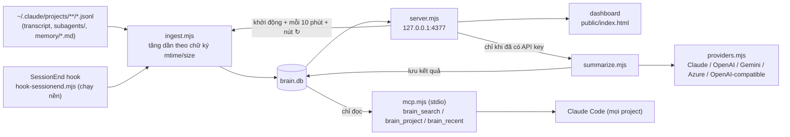
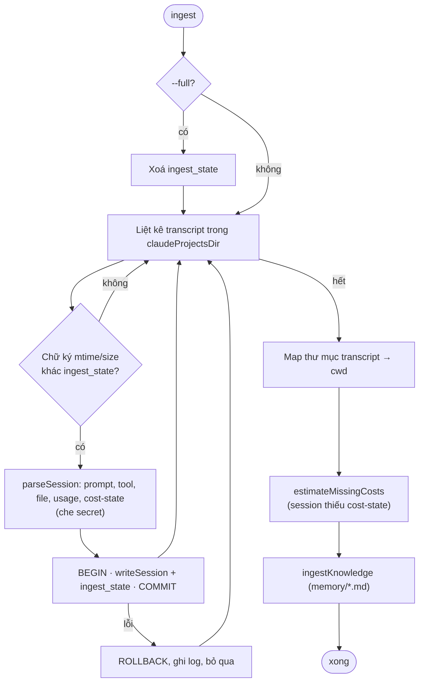
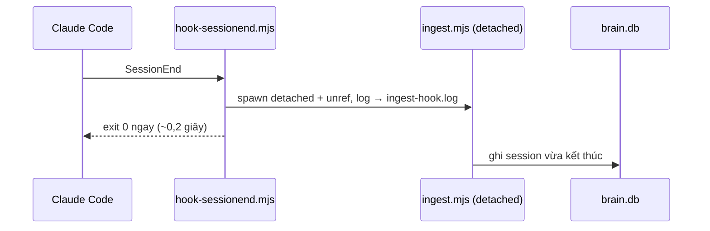
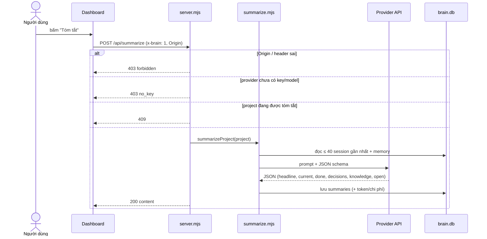

# Personal Brain — Plan thực hiện (bản tự build)

> Ngày lập: 2026-11-09 · Trạng thái: **v0.6.2 — v1 đã chạy được + 💡 Gợi ý tối ưu + chạy nền (`brain start`)** (dashboard local, đọc transcript Claude Code)

## 1. Mục tiêu

Một **bộ nhớ cá nhân** chạy local, trả lời được:

1. **Dự án**: tôi đang làm gì, đã làm gì, đã quyết định gì, knowledge liên quan đến từng dự án.
2. **Thực tế dùng AI**: token, model, chi phí theo ngày / project / model / giờ trong ngày.

Không làm (v1): knowledge graph, vector search, ghi màn hình, sync đa máy, nguồn AI khác ngoài Claude Code.

## 2. Thay đổi so với v0.4

| v0.4 (kế hoạch) | v0.5 (thực tế) | Lý do |
| --- | --- | --- |
| Hook `capture.mjs` ghi prompt/file vào `inbox.jsonl` | **Bỏ.** Đọc thẳng transcript `~/.claude/projects/**/*.jsonl` | Transcript đã có đủ: prompt, tool/file, token theo model, `cost-state` (chi phí USD do Claude Code tính) |
| `remember.mjs` gọi `claude -p` cuối mỗi session | Tóm tắt **theo project, theo yêu cầu**, qua **API của provider tuỳ chọn** (Claude, OpenAI, Gemini, Azure OpenAI, OpenAI-compatible) | Tóm tắt cả project hữu ích hơn từng session; chỉ bật khi đã đăng ký API key |
| CLI `brain today/week/search` | **Dashboard web** `http://localhost:4377` | Cần trực quan: heatmap, timeline, biểu đồ chi phí |
| Không dependency | 1 dependency: `@anthropic-ai/sdk` | Gọi Claude API bằng SDK chính thức |

## 3. Nguyên tắc

1. **Toàn bộ code `.mjs`** (ES Module, Node ≥ 22.5). SQLite dùng `node:sqlite` built-in (có FTS5). Chạy với `--no-warnings` vì `node:sqlite` còn nhãn experimental trên Node 22.
2. **Nguồn sự thật = transcript Claude Code.** `brain.db` là bản lưu trữ: session đã đọc không bị xoá khi transcript gốc bị dọn.
3. **Hook không làm hỏng phiên làm việc**: luôn `exit 0`, việc nặng chạy nền (`detached` + `unref()`).
4. **Local, ngoài repo**: `%USERPROFILE%\.personal-brain\`, server chỉ bind `127.0.0.1`.
5. **AI là tuỳ chọn**: không có API key thì mọi thống kê vẫn chạy, chỉ tắt chức năng tóm tắt.

## 4. Luồng hoạt động

### 4.1 Luồng dữ liệu tổng thể



Sau mỗi lần ingest hoặc tóm tắt, chỉ mục `search_fts` (FTS5) được dựng lại toàn bộ từ `sessions`, `prompts`, `knowledge` và `summaries`. Với khoảng 1.200 dòng, việc này mất khoảng 0,4 giây.

### 4.2 Ingest tăng dần



### 4.3 SessionEnd hook



### 4.4 Tóm tắt AI



## 5. Thư mục

```text
%USERPROFILE%\.personal-brain\
├─ config.json          # gom project, alias, exclude, model/effort/ngôn ngữ tóm tắt
├─ lib.mjs              # đường dẫn, config, schema DB + migration, che secret, tên project
├─ ingest.mjs           # transcript + memory files → brain.db
├─ summarize.mjs        # tóm tắt 1 project bằng provider đang chọn
├─ providers.mjs        # Anthropic (SDK), OpenAI, Gemini, Azure OpenAI, OpenAI-compatible (fetch)
├─ secrets.mjs          # lưu API key theo từng provider, mã hoá Windows DPAPI
├─ query.mjs            # truy vấn dùng chung: chỉ mục + tìm kiếm FTS5, tổng hợp project, session gần đây
├─ server.mjs           # HTTP server + API JSON
├─ mcp.mjs              # MCP server stdio chỉ đọc cho Claude Code (đăng ký bằng claude mcp add)
├─ service.mjs          # brain start|stop|restart|status|autostart (chạy nền, HKCU Run)
├─ hook-sessionend.mjs  # hook SessionEnd: chạy ingest nền rồi thoát ngay
├─ public/index.html    # dashboard (JS thuần + SVG)
├─ brain.cmd            # brain | brain start/stop/restart/status/autostart | brain ingest [--full] | brain summarize "<project>"
├─ secrets.json         # API key đã mã hoá (không commit, không copy sang máy khác)
├─ brain.db             # SQLite
├─ server.log           # log của server chạy nền (tự cắt khi > 5 MB)
└─ ingest-hook.log      # log của hook
```

## 6. Dữ liệu (`brain.db`)

| Bảng | Nội dung | Nguồn |
| --- | --- | --- |
| `sessions` | project, cwd, tiêu đề (`ai-title`), thời gian, số prompt, chi phí + nguồn chi phí (`reported`/`estimated`), dòng +/−, tool dùng, file sửa, tool lỗi, subagent | transcript |
| `prompts` | prompt người dùng gõ (đã che secret, tối đa 1.500 ký tự) | transcript |
| `usage` | mỗi lượt gọi API: model, token input/output/cache đọc/cache ghi, chi phí phân bổ | transcript |
| `model_cost` | chi phí USD từng model trong từng session | `cost-state` |
| `knowledge` | các file memory Claude đã lưu theo project | `~/.claude/projects/*/memory/*.md` |
| `summaries` | tóm tắt AI theo project (JSON) + token/chi phí của lần tóm tắt | Claude API |
| `ingest_state` | chữ ký mtime/size từng session để ingest tăng dần | — |
| `search_fts` | chỉ mục FTS5 (unicode61, bỏ dấu, tự đổi `đ`→`d`); dữ liệu suy ra, dựng lại được bất cứ lúc nào | các bảng trên |

**Chi phí:**

- Lấy từ `cost-state` do Claude Code tự tính theo giá API niêm yết. Đây không phải số tiền thực trả nếu dùng gói subscription.
- Chi phí mỗi session được chia xuống từng lượt gọi theo trọng số token, nên tổng theo ngày khớp đúng tổng của session (đã đối chiếu: chênh lệch 0).
- Session thiếu `cost-state` được ước tính bằng đơn giá $/token học từ các session có `cost-state`, gắn nhãn "ước".

**Gom project:** đường dẫn dưới `workspaceRoot`, cắt theo `projectDepth`. Ví dụ `clients/acme-app`: nhóm `clients` lấy 2 cấp. Các `aliases` gom thư mục tạm, ví dụ `tmp-*` vào `clients/acme-app`.

## 7. Dashboard

**Tab Dự án** (tham khảo Linear/Asana Portfolio, GitHub contribution, Kanban, activity feed):

- **Trang tổng quan:**
  - Ô số liệu: số project đang chạy, ngày làm việc trong 28 ngày, chi phí 30 ngày, số project đã có tóm tắt AI.
  - Heatmap nhịp làm việc của mọi project.
  - Bộ lọc theo trạng thái (Đang chạy ≤ 7 ngày / Chậm lại ≤ 21 / Tạm dừng ≤ 60 / Lưu trữ), theo nhóm khách hàng, theo tên.
  - Thẻ project: câu mô tả, việc đang làm, biểu đồ nhỏ 28 ngày.
- **Trang chi tiết:**
  - Phần đầu: câu tóm tắt và 6 chỉ số (session, prompt, ngày làm việc, chi phí, dòng code, knowledge).
  - Bảng Kanban **Đang làm / Còn mở / Quyết định**.
  - Timeline theo tuần (session + việc ✅ đã xong; session ≤ 1 prompt gộp lại).
  - Heatmap, knowledge, file sửa nhiều nhất theo thư mục, lịch sử prompt.

**Tab AI usage:**

- Ô số liệu: chi phí, token, session, prompt, tỉ lệ cache, dòng code, tool lỗi/subagent.
- Biểu đồ: chi phí theo ngày (tách theo model), theo project, theo giờ trong ngày.
- Bảng theo model; bảng session tốn nhiều nhất. Lọc theo 7/30/90 ngày/tất cả.

**Tab 💡 Gợi ý** (`GET /api/insights?days=`): luật cố định trong `TIP_RULES` (`src/server.mjs`), không gọi AI.

| Kiểm tra | Ngưỡng | Gợi ý |
| --- | --- | --- |
| Tỉ lệ Opus | ≥ 80% chi phí (cao ≥ 90%) | `opusplan`, `model: sonnet` cho command/skill; ước tiết kiệm từ giá/units thực tế Sonnet vs Opus |
| Subagent | ≥ 20 trong kỳ | gán model rẻ cho agent, hạn chế fan-out |
| Tool lỗi | ≥ 20/project hoặc ≥ 5/session | ghi lệnh đúng vào CLAUDE.md, allowlist quyền |
| Cache hit | < 80% ở project ≥ $2 | tránh đổi model/CLAUDE.md giữa session, tránh nghỉ lâu |
| Session dài | ≥ 40 prompt và ≥ $30 | `/clear`, `/compact`, handoff |
| Prompt lặp | ≥ 3 lần (bỏ `/…`, text > 300 ký tự) | biến thành slash command / hook |

Số gợi ý mức "Ưu tiên cao" hiện thành badge trên tab.

**⚙ Cài đặt:** đăng ký/kiểm tra/xoá API key; chọn model, effort, ngôn ngữ tóm tắt.

**Tìm kiếm:** dùng FTS5 trên tiêu đề session, prompt, knowledge và tóm tắt AI. Không phân biệt dấu, khớp đầu từ, xếp theo bm25. Nếu không có kết quả khớp mọi từ thì tìm kết quả khớp bất kỳ từ nào.

## 8. Tóm tắt AI

- **Điều kiện:** chỉ bật khi provider đang chọn đã có API key và model. Nếu chưa, nút bị khoá và server trả 403.
- **Provider hỗ trợ** (mỗi provider một key riêng, chọn 1 provider để dùng):

| Provider | Cách gọi | Kiểm tra key / danh sách model | Ép JSON |
| --- | --- | --- | --- |
| Anthropic (Claude) | `@anthropic-ai/sdk`, mặc định `claude-opus-5-5`, effort `medium`, `fallbacks: "default"` | `GET /v1/models` | structured output (`output_config.format`) |
| OpenAI | REST `/v1/chat/completions` | `GET /v1/models` (lọc bỏ embedding/tts/image…) | `json_schema` → `json_object` → thường |
| Google Gemini | REST `generateContent` | `GET /v1beta/models` (chỉ model hỗ trợ generateContent) | `responseSchema` → chỉ `application/json` |
| Azure OpenAI | REST `/openai/deployments/{deployment}/chat/completions` (endpoint + API version) | danh sách deployment | như OpenAI |
| OpenAI-compatible | REST `{baseUrl}/chat/completions` (OpenRouter, DeepSeek, Groq, Mistral, xAI, Ollama, LM Studio…), key tuỳ chọn | `GET {baseUrl}/models` | như OpenAI |

- **Model:** chọn từ danh sách lấy trực tiếp từ API của provider, không gõ cứng tên model.
- **Lưu key:** key được kiểm tra bằng API danh sách model (không tốn token), rồi lưu mã hoá **Windows DPAPI** trong `secrets.json`. Server không bao giờ trả key ra trình duyệt.
- **Dữ liệu gửi đi:** tối đa 40 session gần nhất (tiêu đề, vài prompt, file sửa) + các file memory của project.
- **Kết quả:** headline, current, done (có ngày), decisions, knowledge, open; output của model được chuẩn hoá về đúng khuôn. Kèm số token; chi phí USD chỉ ước tính được cho model Claude.
- **Đã kiểm tra:** key sai ở cả 5 provider bị từ chối với lỗi rõ ràng; trọn luồng tóm tắt chạy qua một server giả lập chuẩn OpenAI. Chưa chạy với key thật của provider nào.

## 9. Hook & lưu giữ dữ liệu

Đã cài trong `~/.claude/settings.json` (2026-11-09):

```json
"SessionEnd": [{ "hooks": [{ "type": "command",
  "command": "node --no-warnings \"<thư mục cài>/hook-sessionend.mjs\"", "timeout": 10 }] }],
"cleanupPeriodDays": 365
```

- Hook đưa session vừa kết thúc vào `brain.db` kể cả khi server không chạy. Mất khoảng 0,2 giây, chạy nền, luôn `exit 0`.
- `cleanupPeriodDays` = 365: transcript được giữ 1 năm thay vì 30 ngày (mặc định cũ làm mất transcript của các project cũ).
- Không cần hook `UserPromptSubmit` / `PostToolUse`: transcript đã chứa dữ liệu đó.

## 10. Privacy & bảo mật

- Che secret (`api_key|token|password|secret|bearer`, `sk-…`, `ghp_…`, `AKIA…`, JWT) trước khi lưu prompt và knowledge.
- `config.json → exclude`: project không ghi nhận.
- Không lưu nội dung file hay output lệnh, chỉ lưu đường dẫn file.
- Server chỉ nghe ở `127.0.0.1`. Request POST bắt buộc có header `x-brain: 1` và Origin là chính server (chặn CSRF từ trang web khác).
- MCP server chỉ đọc và chỉ chạy qua stdio (không mở cổng). Kết quả tool đi vào ngữ cảnh của session Claude Code đang hỏi.
- Tóm tắt AI gửi prompt/tiêu đề/memory của project lên Claude API. Với dự án khách hàng nhạy cảm, hãy thêm vào `exclude` hoặc không bấm tóm tắt.

## 11. Trạng thái & lộ trình

| Bước | Việc | Trạng thái |
| --- | --- | --- |
| 1. Kiểm tra | `node:sqlite` + FTS5 trên Node v22.19.0; định dạng transcript, `cost-state` | ✅ |
| 2. Ingest | transcript + subagents + memory files, tăng dần | ✅ 70 session, đối chiếu chi phí khớp |
| 3. Dashboard | Dự án (portfolio + chi tiết), AI usage, 💡 Gợi ý tối ưu, tìm kiếm | ✅ |
| 4. Tóm tắt AI | 5 provider (Claude, OpenAI, Gemini, Azure OpenAI, OpenAI-compatible), khoá bằng API key, ⚙ Cài đặt | ✅ code xong — **chưa chạy thử với key thật** |
| 5. Hook & lưu giữ | SessionEnd + `cleanupPeriodDays` 365 | ✅ đã cài — xác nhận qua `ingest-hook.log` sau session kế tiếp |
| 6. Brain cho Claude | MCP server chỉ đọc (`brain_search`, `brain_project`, `brain_recent`) + tìm kiếm FTS5 | ✅ smoke test qua stdio — chưa thử trong session Claude Code thật |
| 7. (Sau) | Nút "Tóm tắt tất cả project đang chạy"; hook SessionStart chèn tóm tắt project; thêm nguồn GitHub Copilot, git commit | — |

## 12. Cần chốt

1. ~~Ngôn ngữ cho script~~ → **Node.js, toàn bộ `.mjs`** (2026-11-09).
2. ~~Ngôn ngữ của tóm tắt~~ → **Mặc định Tiếng Việt**, đổi được trong ⚙ Cài đặt.
3. Project nào cần đưa vào `exclude` (dự án khách hàng nhạy cảm, không gửi lên Claude API)?
